# Wicara

**Tulis apa adanya tentang produk Anda, dan Wicara menyuntingnya jadi tulisan jualan yang rapi tanpa menambah klaim yang tidak bisa dibuktikan.**

Wicara membantu pelaku UMKM di Bali menyiapkan materi pemasaran digital dari isian singkat: deskripsi produk, caption dan tagar, saran harga, versi bahasa Inggris untuk wisatawan, foto produk yang dirapikan, gambar Postingan Instagram, profil Instagram toko, balasan chat pembeli, dan kalender posting tujuh hari. Kata klaim kosong dari draf pengguna dicoret, fakta dari isian distabilo, dan semuanya bisa langsung disalin ke marketplace, Instagram, atau WhatsApp.

Namanya diambil dari kata Jawa dan Bali kuno *wicara*, artinya ucapan atau perkataan. Entri AI Web Innovation Challenge, Bali DigiFest 2026, kategori UMKM & Bisnis.

**Coba di sini:** https://umkm-copilot-bali.vercel.app &nbsp;·&nbsp; **Langsung ke aplikasi:** https://umkm-copilot-bali.vercel.app/app

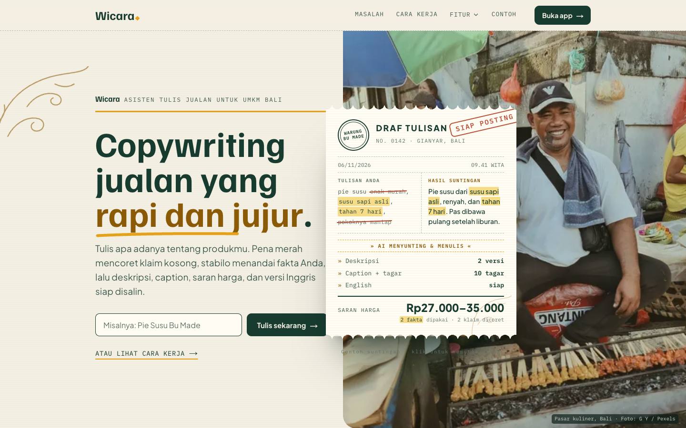

## Description

Wicara adalah web app satu halaman kerja. Pengguna mengisi lima hal tentang produknya (nama, kategori, bahan atau keunggulan, modal per unit, dan pembeli utamanya), lalu menekan satu tombol. Server menyusun empat tulisan siap salin beserta saran harga, lalu fitur lanjutan memakai hasil yang sama untuk foto, Postingan Instagram, profil toko, balasan chat, dan kalender posting.

Pembedanya ada pada lembar suntingan. Draf pengguna ditampilkan seperti kertas yang disunting: kata seperti "enak", "murah", atau "pokoknya mantap" dicoret dengan pena merah, fakta yang benar-benar dipakai di hasil distabilo kuning, dan di atasnya ada hitungan berapa fakta dipakai dan berapa klaim ditambahkan oleh AI.

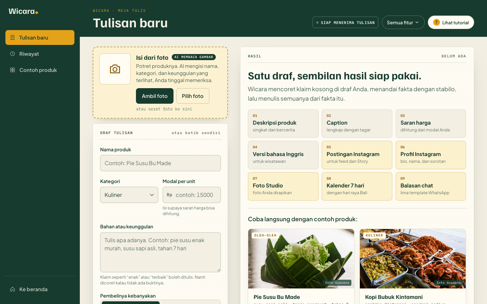

*Halaman /app sebelum diisi: formulir di kiri, sembilan hasil yang bisa dibuat di kanan, dan contoh produk untuk mencoba tanpa mengetik.*

## Problem & Target User

Banyak UMKM di Bali, seperti warung, perajin, produsen kuliner, dan toko oleh-oleh, punya produk yang bagus tetapi kesulitan memasarkannya secara digital. Pemiliknya jarang punya waktu atau keterampilan menulis deskripsi dan caption yang menarik, sering ragu menentukan harga jual, dan belum bisa menjangkau wisatawan asing karena kendala bahasa. Akibatnya produk mereka kalah bersaing di marketplace dan media sosial.

Pengguna utama Wicara adalah pemilik atau pengelola UMKM di Bali yang berjualan secara daring maupun di lokasi wisata, termasuk yang baru mulai memakai media sosial untuk berjualan.

## Key Features

Semua fitur di bawah sudah berfungsi di situs live. Lama tunggu diukur di https://umkm-copilot-bali.vercel.app pada 12 November 2026 siang, dengan Claude Haiku 5.5 sebagai model utama.

| Fitur | Hasil | Lama tunggu |
| --- | --- | --- |
| Tulisan jualan | deskripsi singkat dan bercerita, caption dan 8–12 tagar, saran harga, versi bahasa Inggris | umumnya 8–12 detik |
| Lembar suntingan | draf dengan klaim kosong dicoret, fakta distabilo, hitungan fakta dan klaim | bersamaan dengan tulisan |
| Isi dari foto | nama, kategori, dan keunggulan terisi dari foto produk | 3–4 detik |
| Foto Studio | skor foto, masalah, tips, dan foto asli yang dirapikan | 3–7 detik |
| Postingan Instagram | gambar feed 1080×1080 dan Story 1080×1920, tiga templat | langsung, digambar di peramban |
| Profil Instagram | nama profil, username, tiga versi bio, sorotan, ide postingan pertama | sekitar 10 detik |
| Balas chat pembeli | lima template balasan WhatsApp | 5–11 detik |
| Kalender 7 hari | rencana posting seminggu dengan hari raya Bali | 8–13 detik |

Fitur pendukung: tombol Salin di setiap bagian dan "Salin semua", riwayat lima tulisan terakhir di peramban, tutorial interaktif saat pertama kali membuka /app, menu Semua fitur, dan mode contoh berlabel jelas kalau server belum diberi API key.

### Tulisan jualan dan lembar suntingan

Isian contoh di bawah ini sengaja memuat klaim kosong: Klepon Bu Made, kategori Kuliner, keunggulan "klepon enak murah, isi gula merah, kelapa parut, dibuat tiap pagi, pokoknya mantap", modal Rp8.000, pembeli wisatawan.

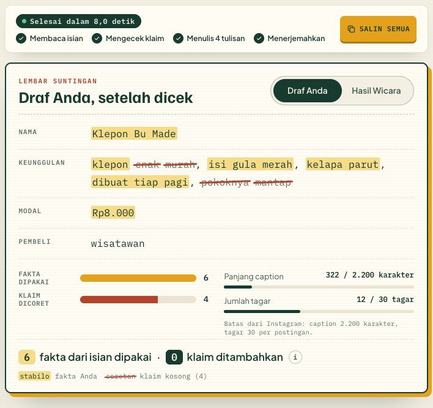

*Pada percobaan ini enam fakta dari isian dipakai, empat klaim kosong dicoret dari draf, dan penghitung menunjukkan 0 klaim ditambahkan.*

Hasilnya empat tulisan: deskripsi singkat untuk marketplace, deskripsi bercerita dari sudut pembeli (kapan dan untuk apa produk dipakai), caption dengan tagar, dan versi bahasa Inggris. Bagian yang berasal dari isian distabilo supaya mudah diperiksa.

### Saran harga dengan grafik modal dan margin

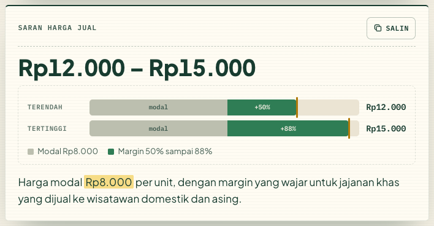

*Modal Rp8.000 menghasilkan saran Rp12.000–Rp15.000; grafik memperlihatkan bagian modal dan margin 50–88% di setiap ujung rentang.*

Harga hanya dihitung kalau modal per unit diisi. Tanpa modal, Wicara tidak menebak: API mengembalikan `min` dan `max` bernilai 0 dengan alasan "Modal per unit belum diisi, jadi saran harga belum dihitung.", kartu harga meminta pengguna mengisi modal, dan baris harga tidak digambar di Postingan Instagram. Kalau modal diisi tetapi angka dari AI tidak masuk akal (nol, terbalik, atau di bawah modal), server memakai rumus margin per target pasar.

### Isi dari foto

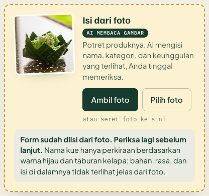

*AI hanya menulis yang terlihat di foto dan mencatat keraguannya, di sini nama kue yang hanya perkiraan serta bahan dan isi yang tidak tampak.*

Foto JPEG atau PNG (maksimal 4 MB) diperkecil di peramban sampai sisi terpanjang 1280 piksel sebelum dikirim. Hasilnya hanya mengisi kolom formulir; pengguna tetap memeriksa dan menekan tombol sendiri.

### Foto Studio

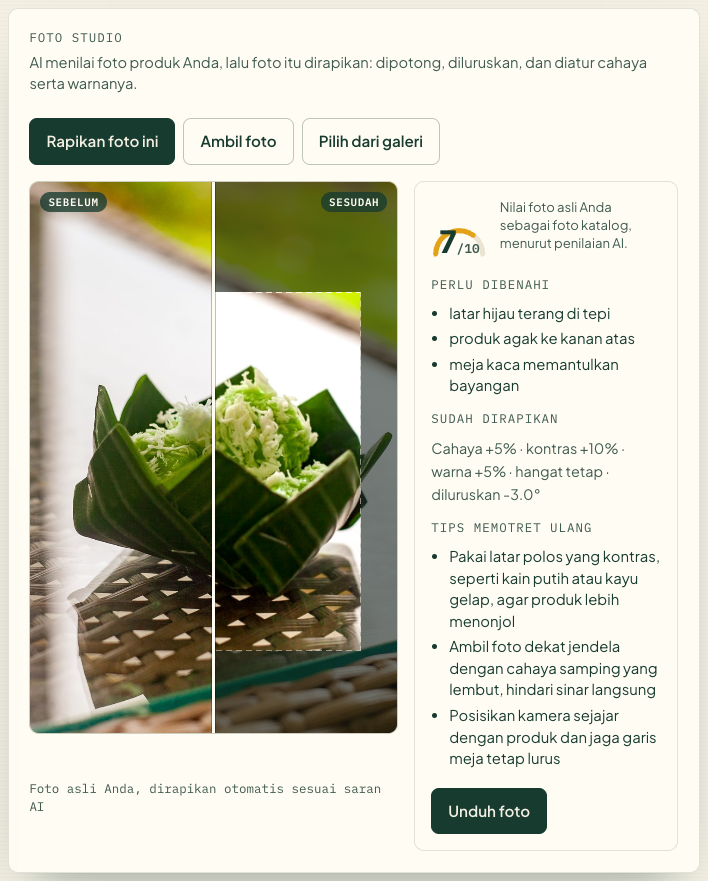

*Geser garis putih untuk membandingkan: sisi kanan adalah foto yang sama setelah dipotong, diluruskan, dan diatur cahayanya.*

Claude menilai foto produk (skor 1–10, sampai tiga masalah, dan tiga tips memotret ulang) lalu mengembalikan pengaturan perbaikan: kotak potong, rotasi, kecerahan, kontras, saturasi, dan kehangatan. Pengaturan itu diterapkan ke foto asli di peramban dengan kanvas. Tidak ada gambar baru yang dibuat AI, dan labelnya berbunyi "Foto asli Anda, dirapikan otomatis sesuai saran AI". Contoh lain ada di [docs/studio-contoh.png](docs/studio-contoh.png).

### Postingan Instagram

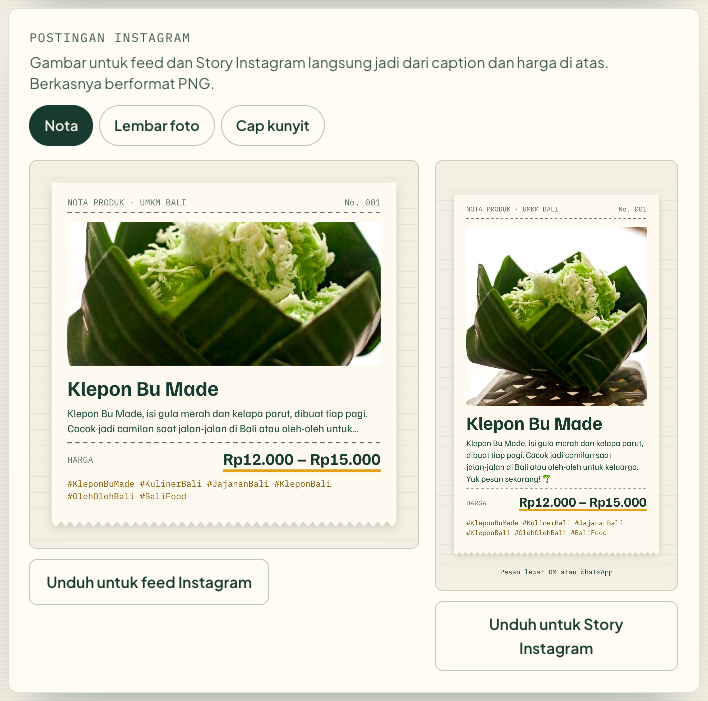

*Templat Nota untuk feed dan Story, memakai foto hasil Foto Studio, nama produk, potongan caption, harga, dan tagar.*

Gambar digambar ulang di kanvas setiap kali isinya berubah, setelah font lokal termuat, lalu diunduh sebagai PNG. Ada tiga templat: Nota, Lembar foto, dan Cap kunyit.

### Profil Instagram toko

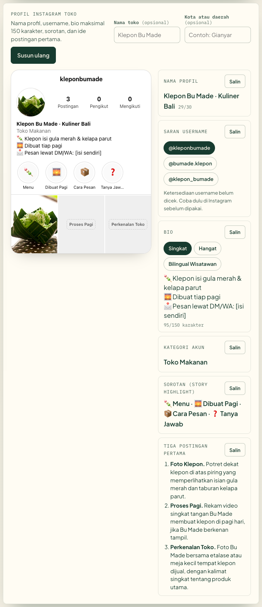

*Pratinjau bergaya profil Instagram tanpa logo atau aset resmi, dengan bio yang bisa diganti versinya dan penghitung karakter.*

AI menyusun nama profil (maksimal 30 karakter), tiga saran username, tiga versi bio (maksimal 150 karakter, satu di antaranya dwibahasa), kategori akun bisnis, 4–5 nama sorotan, dan ide tiga postingan pertama. Batas karakter Instagram ditegakkan di server, dan ketersediaan username tetap perlu dicek sendiri.

### Balas chat pembeli

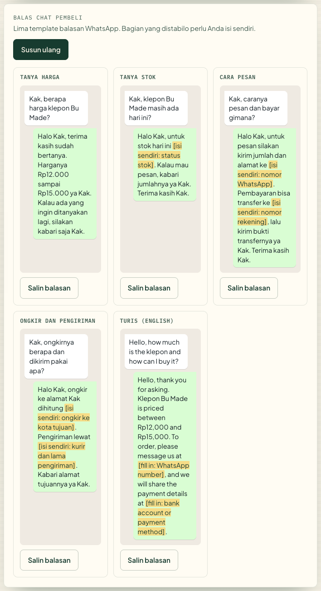

*Info yang tidak diisi penjual, seperti ongkir, rekening, atau status stok, ditulis sebagai `[isi sendiri: ...]` dan diberi stabilo.*

Lima pertanyaan yang paling sering masuk: harga, stok, cara pesan, ongkir dan pengiriman, serta pertanyaan wisatawan dalam bahasa Inggris. Setiap kartu punya pratinjau gelembung chat dan tombol Salin.

### Kalender konten 7 hari

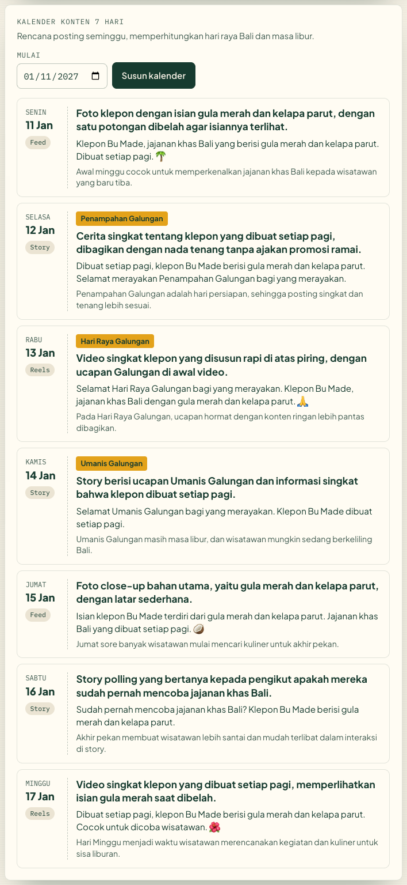

*Tiga hari pertama dari rencana seminggu: ide posting, format (Feed, Story, atau Reels), caption singkat, dan alasannya.*

Server menyisipkan hari raya Bali, libur nasional, dan libur sekolah yang jatuh di rentang tanggal itu ke prompt, jadi AI tidak menebak tanggal hari raya sendiri. Data tanggalnya ada di `lib/hari-raya-bali.js` beserta sumbernya.

### Menu Semua fitur

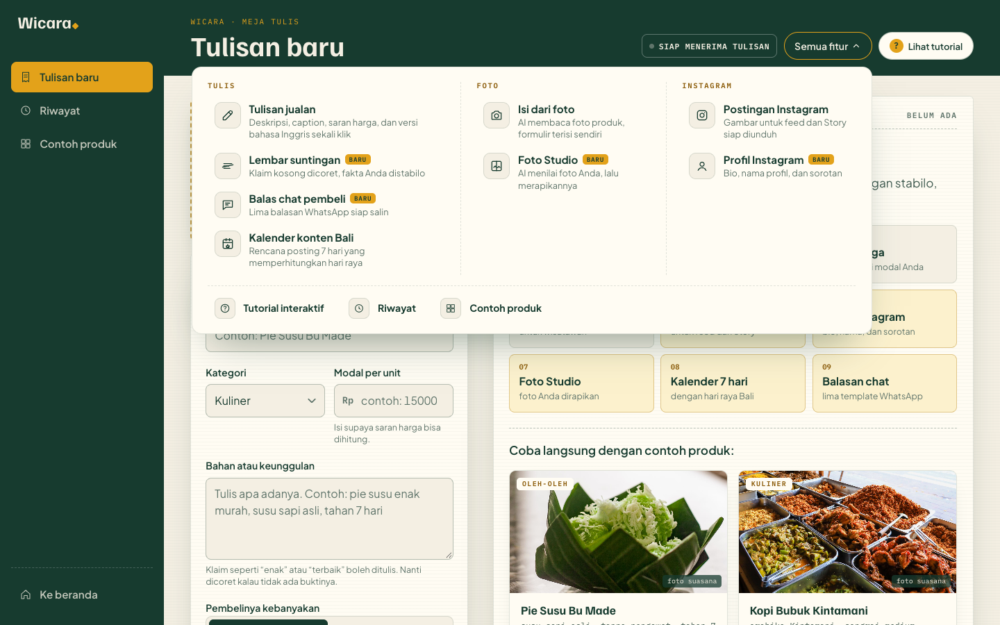

*Menu Semua fitur mengelompokkan fitur menjadi Tulis, Foto, dan Instagram, lalu menggulir ke kartu yang dipilih.*

### Di layar HP

| Beranda, 375 piksel | Aplikasi setelah tulisan jadi, 375 piksel |
| --- | --- |
| 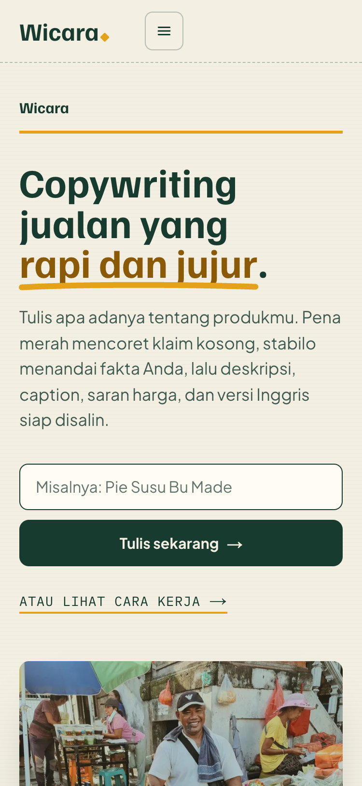 | 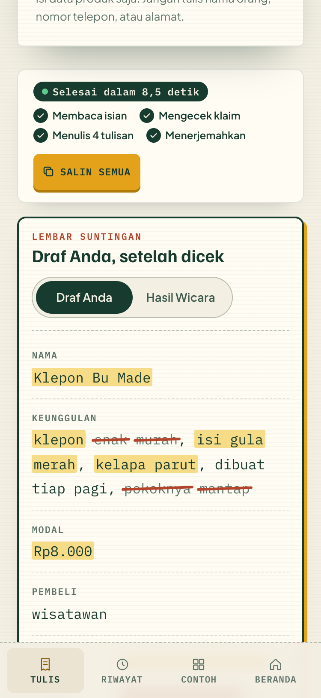 |

## Tech Stack

| Bagian | Teknologi |
| --- | --- |
| Frontend | Next.js 15 (App Router), React 19, CSS biasa dan CSS Modules, Canvas API untuk Foto Studio dan Postingan Instagram |
| Backend | Next.js Route Handler di runtime Node.js: `/api/generate`, `/api/foto`, `/api/studio`, `/api/profil`, `/api/balasan`, `/api/kalender` |
| AI | Utama: Claude API (Anthropic) lewat SDK resmi `@anthropic-ai/sdk`, model `claude-haiku-5-5`. Cadangan: Gemini API lewat `@google/genai`, rantai `gemini-3.5-flash`, `gemini-3.6-flash`, `gemini-3.5-flash-lite`, `gemini-3.8-flash` |
| Validasi | Zod untuk skema keluaran AI dan pemeriksaan ulang di server |
| Database / storage | Tidak memakai database. Riwayat disimpan di `localStorage`, cache hasil di `sessionStorage` peramban |
| Hosting | Vercel |

## AI Implementation

AI adalah inti produk: tanpa model bahasa, aplikasi tidak bisa menyusun tulisan yang menyesuaikan produk, kategori, dan target pasar, membaca foto, atau menyusun profil dan kalender.

| Endpoint | Masukan | Keluaran (JSON) |
| --- | --- | --- |
| `/api/generate` | nama, kategori, keunggulan, modal, target | `deskripsi_singkat`, `deskripsi_cerita`, `caption`, `hashtags`, `harga` (`min`, `max`, `alasan`), `english` |
| `/api/foto` | foto produk | `nama`, `kategori`, `keunggulan`, `catatan_ketidakpastian` |
| `/api/studio` | foto produk | `nilai`, `masalah`, `perbaikan` (`crop`, `kecerahan`, `kontras`, `saturasi`, `kehangatan`, `rotasi`), `tips_foto_ulang` |
| `/api/profil` | data produk, nama toko dan kota (opsional) | `nama_profil`, `saran_username`, `bio`, `kategori_akun`, `sorotan`, `postingan_pertama` |
| `/api/balasan` | data produk, harga, deskripsi singkat | lima pasang pertanyaan dan balasan |
| `/api/kalender` | data produk, ringkasan, tanggal mulai | tujuh hari berisi `ide_posting`, `format`, `caption_singkat`, `alasan` |

- **Model utama**: Claude Haiku 5.5 (`claude-haiku-5-5`) lewat Claude API, dengan *structured output* (`output_config.format` dari skema Zod) dan effort `low` supaya cepat. Model yang sama membaca teks dan foto.
- **Cadangan**: kalau Claude galat, menolak, atau `ANTHROPIC_API_KEY` kosong, server pindah ke Gemini dengan API key free tier dan skema yang sama (`responseJsonSchema`). Rantainya `gemini-3.5-flash`, `gemini-3.6-flash`, `gemini-3.5-flash-lite`, lalu `gemini-3.8-flash`. Model yang sibuk (503) dicoba ulang sekali, model yang kuotanya habis (429) langsung dilewati karena kuota free tier dihitung per model, setiap model diberi waktu 9 detik, dan total waktu tunggu dibatasi 25 detik. Pada Tahap 1, ketika Gemini masih menjadi penyedia utama, satu tulisan memakan 15–26 detik.
- **Hemat panggilan**: satu klik memakai satu panggilan kecuali gagal, isian yang persis sama diambil dari cache `sessionStorage`, dan tombol dinonaktifkan selama permintaan berjalan. Kalau semua model penuh, pengguna mendapat pesan jujur dan tombol untuk melihat hasil berlabel Contoh; aplikasi tidak diam-diam menggantinya dengan contoh.
- **Menjaga fakta**: instruksi sistem di fitur teks (generate, profil, balasan, kalender) melarang AI menambah fakta di luar isian, seperti asal-usul, sejarah keluarga, cara membuat, rasa atau kemasan yang tidak disebut, kelangkaan stok, promo, garansi, atau testimoni. Instruksi juga melarang kata klaim kosong dari daftar di `lib/klaim.js` (misalnya "terbaik", "enak", "murah", "stok terbatas", "berkualitas", "best") di teks, tagar, dan versi bahasa Inggris, serta tidak meneruskan klaim yang ditulis pengguna. Setelah jawaban datang, server memeriksa daftar kata itu, dengan tagar dipecah per kata. Kalau ada, server meminta ulang satu kali dengan pesan koreksi yang menyebut katanya. Kalau hasil kedua masih memuat klaim, hasil dikembalikan apa adanya, dan lembar suntingan menampilkan jumlah "klaim ditambahkan" dari daftar yang sama.
- **Pengaman lain di server**: harga tanpa modal dipaksa 0/0, angka Foto Studio dijepit (penyesuaian warna -0,3 sampai 0,3, rotasi -10 sampai 10 derajat), batas Instagram ditegakkan (bio 150, nama 30, username 30 dengan huruf kecil, angka, titik, dan garis bawah, sorotan 15), dan kalau keunggulan kosong hanya ada satu penanda `[isi sendiri: bahan atau keunggulan]` di deskripsi singkat.
- **Validasi**: jawaban AI diperiksa ulang dengan Zod. Jawaban yang tidak sesuai skema ditolak di server dan pengguna melihat pesan galat.
- **Keamanan key**: `ANTHROPIC_API_KEY` dan `GEMINI_API_KEY` hanya dibaca di server. Peramban memanggil route API Wicara, bukan Claude atau Gemini secara langsung.

Rincian lengkap ada di [docs/AI-DISCLOSURE.md](docs/AI-DISCLOSURE.md).

## Architecture / Data Flow

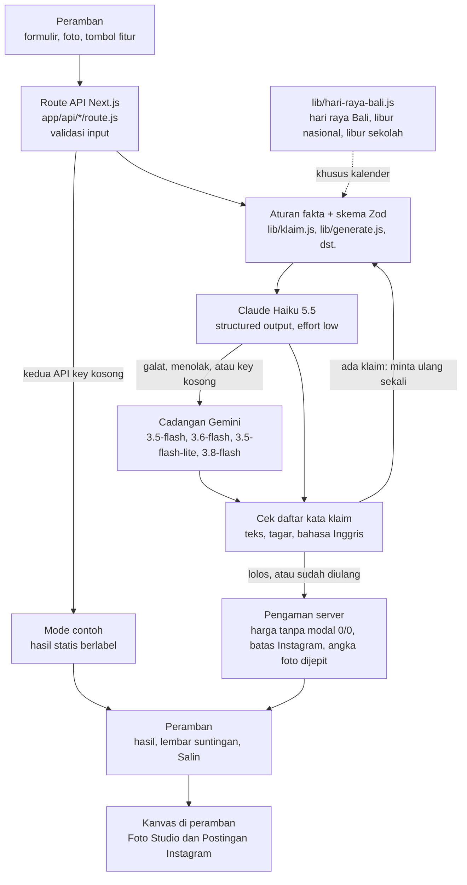

Struktur berkas:

- `app/(landing)/`: beranda.
- `app/app/`: halaman aplikasi.
- `app/components/fitur/`: komponen `FotoKeForm`, `FotoStudio`, `PostinganIG`, `ProfilInstagram`, `BalasChat`, dan `KalenderKonten`.
- `app/components/Suntingan.js`: lembar suntingan, memakai daftar klaim yang sama dengan server.
- `app/api/*/route.js`: enam endpoint dan validasi input.
- `lib/ai.js`: satu pintu panggilan AI, Claude dulu lalu cadangan Gemini.
- `lib/claude.js` dan `lib/gemini.js`: panggilan ke masing-masing penyedia.
- `lib/klaim.js`: daftar kata klaim, aturan fakta, dan minta ulang sekali.
- `lib/generate.js`, `lib/foto.js`, `lib/studio.js`, `lib/profil.js`, `lib/balasan.js`, `lib/kalender.js`: prompt, skema keluaran, pengaman, dan data mode contoh tiap fitur.
- `lib/hari-raya-bali.js`: tanggal hari raya Bali, libur nasional, dan libur sekolah November 2026 sampai Desember 2027, dengan sumber tiap tanggal.
- `lib/klien.js`: panggilan dari peramban dengan cache `sessionStorage`.

## Installation / Run Instructions

Butuh Node.js 20 atau lebih baru.

```bash
npm install
cp .env.example .env.local
```

Isi `ANTHROPIC_API_KEY` di `.env.local` dengan API key dari [Claude Console](https://platform.claude.com), dan `GEMINI_API_KEY` dengan API key dari [Google AI Studio](https://aistudio.google.com/apikey) sebagai cadangan. Kalau keduanya kosong, aplikasi berjalan di mode contoh.

```bash
npm run dev
```

Buka http://localhost:3000 untuk beranda dan http://localhost:3000/app untuk aplikasi.

Versi produksi: `npm run build` lalu `npm start`. Untuk Vercel, tambahkan `ANTHROPIC_API_KEY` dan `GEMINI_API_KEY` di pengaturan Environment Variables proyek.

## Deployment URL

https://umkm-copilot-bali.vercel.app (beranda) dan https://umkm-copilot-bali.vercel.app/app (aplikasi)

## Demo Account (jika diperlukan - jangan simpan password sensitif di public repo)

Tidak diperlukan. Aplikasi bisa dipakai tanpa login.

## Known Limitations

- Pemeriksaan klaim berbasis daftar kata. Kata di luar daftar dan kalimat karangan tanpa kata klaim (misalnya gambaran rasa atau kemasan yang tidak diisi) masih mungkin lolos, jadi hasil tetap perlu dibaca ulang sebelum diunggah.
- Claude API berbayar per token dari kredit akun. Kalau kredit habis atau Claude galat, permintaan pindah ke Gemini free tier, yang punya batas permintaan per menit dan per hari dan kadang sibuk (503), sehingga jawaban cadangan bisa memakan waktu sampai sekitar 25 detik. Kalau semua model penuh, aplikasi meminta pengguna mencoba lagi nanti.
- Saat permintaan jatuh ke cadangan Gemini free tier, Google dapat memakai input dan output untuk meningkatkan produknya. Pengguna sebaiknya tidak memasukkan data pribadi atau rahasia ke dalam formulir, dan tidak memotret wajah orang atau dokumen pribadi untuk fitur foto.
- Saran harga adalah perkiraan dari modal, kategori, dan target pasar, bukan hasil riset pasar, dan hanya dihitung kalau modal diisi. Pengguna tetap perlu menyesuaikan dengan kondisi di lapangan.
- Foto Studio hanya memotong, meluruskan, dan mengatur cahaya serta warna. Latar yang ramai atau orang di foto tetap ada karena tidak ada model pembuat gambar yang dipakai.
- Riwayat hanya tersimpan di peramban yang dipakai dan hilang kalau data peramban dihapus. Belum ada akun pengguna atau sinkronisasi antarperangkat.
- Tanggal hari raya Bali 2027 diambil dari Kalender Pendidikan Provinsi Bali 2026/2027 yang masih menandainya sebagai perkiraan sampai Surat Edaran Gubernur Bali 2027 terbit. Purnama dan Tilem belum dimasukkan.

## Third-party Resources / Credits

- [Next.js](https://nextjs.org) dan [React](https://react.dev) (MIT)
- [@anthropic-ai/sdk](https://www.npmjs.com/package/@anthropic-ai/sdk), SDK resmi Claude API (MIT)
- [@google/genai](https://www.npmjs.com/package/@google/genai), SDK resmi Gemini (Apache-2.0)
- [Zod](https://zod.dev) untuk skema dan validasi (MIT)
- [GSAP](https://gsap.com) (lisensi standar GSAP, gratis) dan [Lenis](https://lenis.darkroom.engineering) (MIT) untuk animasi dan gulir halus
- Font [Familjen Grotesk](https://fonts.google.com/specimen/Familjen+Grotesk), [Plus Jakarta Sans](https://fonts.google.com/specimen/Plus+Jakarta+Sans), dan [IBM Plex Mono](https://fonts.google.com/specimen/IBM+Plex+Mono) dari Google Fonts (SIL Open Font License 1.1). Berkas WOFF2 subset Latin disimpan di `app/fonts/` dan dimuat lewat `next/font/local`, jadi build tidak bergantung pada server Google. Rincian lisensi di `app/fonts/LICENSE.md`
- Claude API oleh Anthropic (penyedia AI utama) dan Gemini API oleh Google (cadangan)
- Struk contoh di beranda dan ikon digambar langsung dengan CSS dan SVG inline, tanpa pustaka ikon atau gambar hasil generator
- Foto dari [Pexels](https://www.pexels.com) (lisensi Pexels), disimpan di `public/foto/`:
  - `hero-umkm.jpg`, pedagang sate di pasar kuliner Bali, oleh [G Y](https://www.pexels.com/photo/31246481/)
  - `pasar.jpg`, kunyit, jeruk limau, dan ikan teri di pasar Bali, oleh [Stijn Dijkstra](https://www.pexels.com/photo/38330312/)
  - `kuliner.jpg`, lauk makanan jalanan Bali, oleh [Kevin Yung](https://www.pexels.com/photo/36892251/)
  - `kerajinan.jpg`, pengrajin ukir kayu di Ubud, oleh [Smaart](https://www.pexels.com/photo/32064709/)
  - `fesyen.jpg`, penenun di depan kain tenun tangan, oleh [Andreas Suwardy](https://www.pexels.com/photo/40524482/)
  - `oleh-oleh.jpg`, jaja Bali dalam takir daun pisang, oleh [Evert jan Hoek](https://www.pexels.com/photo/36858325/)
- Tangkapan layar di `docs/readme/` diambil dari situs live dengan headless Chrome pada 12 November 2026

## Team Members

| Nama | Peran |
| --- | --- |
| Gianne Angely Puspa Pilatus (tim Kopi Sisa Semalam, Teknik Informatika, Universitas Dhyana Pura) | Peserta individu: ide, desain, pengembangan, dan dokumentasi |
