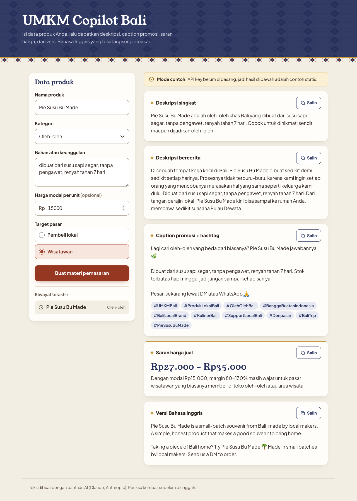

# Wicara

## Description

Wicara adalah web app yang membantu pelaku UMKM di Bali menyiapkan materi pemasaran digital. Pengguna cukup mengisi data singkat tentang produknya, lalu AI menyusun deskripsi produk, caption promosi beserta hashtag, saran harga jual, dan versi Bahasa Inggris untuk wisatawan. Semua hasil bisa langsung disalin ke marketplace, Instagram, atau WhatsApp.

Namanya diambil dari kata Jawa/Bali kuno *wicara*, yang berarti ucapan atau perkataan.

Entri AI Web Innovation Challenge, Bali DigiFest 2026, kategori UMKM & Bisnis.



## Problem & Target User

Banyak UMKM di Bali, seperti warung, perajin, produsen kuliner, dan toko oleh-oleh, punya produk yang bagus tetapi kesulitan memasarkannya secara digital. Pemiliknya jarang punya waktu atau keterampilan menulis deskripsi dan caption yang menarik, sering ragu menentukan harga jual, dan belum bisa menjangkau wisatawan asing karena kendala bahasa. Akibatnya produk mereka kalah bersaing di marketplace dan media sosial.

Pengguna utama aplikasi ini adalah pemilik atau pengelola UMKM di Bali yang berjualan secara daring maupun di lokasi wisata, termasuk yang baru mulai memakai media sosial untuk berjualan.

## Key Features

Fitur berikut sudah berfungsi:

- **Form data produk**: nama produk, kategori, bahan atau keunggulan, harga modal (opsional), dan target pasar (pembeli lokal atau wisatawan).
- **Generate sekali klik** dengan hasil per bagian:
  - deskripsi produk dalam dua versi, singkat untuk marketplace dan bercerita untuk media sosial;
  - caption promosi untuk Instagram/WhatsApp dan 8–12 hashtag yang relevan dengan Bali;
  - saran rentang harga jual dalam Rupiah beserta alasannya, dihitung dari harga modal bila diisi;
  - versi Bahasa Inggris (deskripsi dan caption) untuk wisatawan asing.
- **Tombol Salin** di setiap bagian hasil.
- **Riwayat** lima produk terakhir, tersimpan di browser pengguna.
- **Isi dari foto**: pengguna memotret atau memilih foto produk, lalu AI membaca foto dan mengisi nama, kategori, dan keunggulan di form. AI hanya menulis yang terlihat di foto dan mencatat bagian yang meragukan.
- **Postingan Instagram siap unduh**: hasil generate digambar ke kanvas ukuran feed (1080×1080) dan story (1080×1920) dengan tiga template bergaya nota, lalu diunduh sebagai PNG. Semua proses ini terjadi di browser.
- **Kalender konten 7 hari**: AI menyusun rencana posting seminggu yang memperhitungkan hari raya Bali (Galungan, Kuningan, Nyepi, Saraswati, Pagerwesi, Siwaratri), libur nasional, dan libur sekolah. Data tanggalnya disimpan di `lib/hari-raya-bali.js` beserta sumbernya.
- **Balas chat pembeli**: AI menyiapkan lima template balasan WhatsApp untuk pertanyaan yang paling sering masuk (harga, stok, cara pesan, ongkir, dan pertanyaan turis dalam Bahasa Inggris), lengkap dengan pratinjau gelembung chat dan tombol Salin. Info yang tidak diisi penjual, seperti ongkir, rekening, atau status stok, ditulis sebagai `[isi sendiri: ...]` dan diberi stabilo.
- **Mode contoh**: kalau server belum diberi API key, aplikasi tetap bisa dicoba dan menampilkan hasil contoh yang diberi label jelas.

## Tech Stack

| Bagian | Teknologi |
| --- | --- |
| Frontend | Next.js 15 (App Router), React 19, CSS biasa |
| Backend | Next.js Route Handler (`POST /api/generate`, `/api/foto`, `/api/kalender`) di runtime Node.js |
| AI | Utama: Claude API (Anthropic) lewat SDK resmi `@anthropic-ai/sdk`, model `claude-haiku-5-5`. Cadangan: Gemini API lewat `@google/genai`, rantai `gemini-3.5-flash`, `gemini-3.6-flash`, `gemini-3.5-flash-lite`, `gemini-3.8-flash` |
| Database / storage | Tidak memakai database. Riwayat disimpan di `localStorage` browser |
| Hosting | Vercel |

## AI Implementation

AI adalah inti produk: tanpa model bahasa, aplikasi tidak bisa menyusun teks pemasaran yang menyesuaikan produk, kategori, dan target pasar.

- **Model utama**: Claude Haiku 5.5 (`claude-haiku-5-5`) dari Anthropic, dipanggil lewat Claude API dengan *structured output* (`output_config.format` dari skema Zod yang sama) dan effort `low` supaya cepat. Model yang sama dipakai untuk teks pemasaran, membaca foto produk, dan kalender. Kalau Claude galat, menolak, atau `ANTHROPIC_API_KEY` kosong, server otomatis pindah ke cadangan Gemini.
- **Cadangan**: Google Gemini lewat Gemini API dengan API key free tier. Server mencoba berurutan `gemini-3.5-flash`, `gemini-3.6-flash`, `gemini-3.5-flash-lite`, lalu `gemini-3.8-flash`, pindah ke model berikutnya kalau sibuk (503/429) atau tidak menjawab dalam 9 detik. Satu klik memakai satu panggilan kecuali gagal, isian yang persis sama diambil dari cache sessionStorage, dan kalau semua model penuh pengguna mendapat pesan jujur plus tombol untuk melihat hasil berlabel Contoh. Model yang sibuk dicoba ulang sekali; model yang kuotanya habis (429) langsung dilewati karena kuota free tier dihitung per model. Total waktu tunggu dibatasi 25 detik. Respons API menyertakan field `model` berisi model yang benar-benar menjawab.
- **Empat fungsi AI**:
  - `/api/generate`: teks pemasaran dari data produk.
  - `/api/foto`: membaca foto produk (JPEG/PNG, maksimal 4 MB, diperkecil di browser sampai 1280 px) dan mengisi form.
  - `/api/kalender`: rencana posting 7 hari. Server menyisipkan hari raya dan libur yang jatuh di rentang tanggal itu ke prompt, jadi AI tidak menebak tanggal hari raya sendiri.
  - `/api/balasan`: lima template balasan WhatsApp dari data produk dan harga. Instruksinya melarang mengarang ongkir, alamat, rekening, stok, varian, atau kemasan; bagian itu diganti placeholder.
- **Input**: data produk dari form, disusun menjadi prompt pendek di server. Instruksi sistem meminta bahasa yang wajar, melarang klaim berlebihan, dan melarang AI mengarang fakta yang tidak ada di data (misalnya sertifikat atau penghargaan).
- **Output**: JSON terstruktur yang dibatasi skema (`responseJsonSchema`), misalnya untuk generate berisi `deskripsi_singkat`, `deskripsi_cerita`, `caption`, `hashtags`, `harga` (`min`, `max`, `alasan`), dan `english` (`description`, `caption`). Server memvalidasi hasil dengan Zod sebelum dikirim ke browser, sehingga setiap bagian di layar selalu terisi.
- **Penanganan galat**: kalau semua model gagal (sibuk, kuota habis, key tidak valid, atau jawaban tidak sesuai skema), pengguna melihat pesan galat yang jelas. Aplikasi tidak diam-diam menggantinya dengan hasil contoh.
- **Keamanan key**: API key hanya dibaca di server dari environment variable `ANTHROPIC_API_KEY` dan `GEMINI_API_KEY`. Browser tidak pernah memanggil Claude atau Gemini secara langsung.

Rincian lengkap ada di [docs/AI-DISCLOSURE.md](docs/AI-DISCLOSURE.md).

## Architecture / Data Flow

```
Browser (form React)
   │  POST /api/generate  { nama, kategori, keunggulan, modal, target }
   │  (juga /api/foto untuk foto produk, /api/kalender untuk rencana 7 hari)
   ▼
Next.js Route Handler  (app/api/*/route.js)
   │  validasi input
   ├── kedua key kosong ──► hasil contoh statis (lib/generate.js) ───────┐
   │                                                                     │
   └── ada key ──► Claude Haiku 5.5 ──(galat)──► rantai Gemini           │
                                 │  JSON sesuai skema                    │
                                 ▼                                       │
                           validasi Zod                                  │
                                 │                                       │
   ◄─────────────────────────────┴───────────────────────────────────────┘
Browser menampilkan hasil per bagian + tombol Salin, lalu menyimpan riwayat di localStorage
```

Struktur folder:

- `app/`: halaman landing dan aplikasi.
- `app/components/fitur/`: komponen `FotoKeForm`, `PostinganIG`, dan `KalenderKonten`.
- `app/api/generate`, `app/api/foto`, `app/api/kalender`, `app/api/balasan`: endpoint dan validasi input.
- `lib/ai.js`: satu pintu panggilan AI, Claude dulu lalu cadangan Gemini.
- `lib/claude.js`: panggilan Claude dengan structured output.
- `lib/gemini.js`: panggilan Gemini dengan rantai model cadangan.
- `lib/generate.js`, `lib/foto.js`, `lib/kalender.js`, `lib/balasan.js`: prompt, skema keluaran, dan data mode contoh tiap fitur.
- `lib/hari-raya-bali.js`: tanggal hari raya Bali, libur nasional, dan libur sekolah November 2026 sampai Desember 2027, dengan sumber tiap tanggal.

## Installation / Run Instructions

Butuh Node.js 20 atau lebih baru.

```bash
npm install
cp .env.example .env.local
```

Isi `ANTHROPIC_API_KEY` di `.env.local` dengan API key dari [Claude Console](https://platform.claude.com), dan `GEMINI_API_KEY` dengan API key dari [Google AI Studio](https://aistudio.google.com/apikey) sebagai cadangan. Kalau keduanya kosong, aplikasi berjalan di mode contoh.

```bash
npm run dev
```

Buka http://localhost:3000.

Versi produksi: `npm run build` lalu `npm start`. Untuk Vercel, tambahkan `ANTHROPIC_API_KEY` dan `GEMINI_API_KEY` di pengaturan Environment Variables proyek.

## Deployment URL

https://umkm-copilot-bali.vercel.app (beranda) dan https://umkm-copilot-bali.vercel.app/app (aplikasi)

## Demo Account (jika diperlukan - jangan simpan password sensitif di public repo)

Tidak diperlukan. Aplikasi bisa dipakai tanpa login.

## Known Limitations

- Claude API berbayar per token dari kredit akun. Kalau kredit habis atau Claude galat, permintaan pindah ke Gemini free tier, yang punya batas permintaan per menit dan per hari dan kadang sibuk (503), sehingga jawaban cadangan bisa memakan waktu sampai sekitar 25 detik. Kalau semua model penuh, aplikasi menampilkan pesan agar pengguna mencoba lagi nanti.
- Saat permintaan jatuh ke cadangan Gemini free tier, Google dapat memakai input dan output untuk meningkatkan produknya. Pengguna sebaiknya tidak memasukkan data pribadi atau rahasia ke dalam form, dan tidak memotret wajah orang atau dokumen pribadi untuk fitur foto.
- Saran harga adalah perkiraan dari AI berdasarkan harga modal dan kategori, bukan hasil riset pasar. Pengguna tetap perlu menyesuaikan dengan kondisi di lapangan.
- Teks hasil AI bisa saja kurang tepat, jadi tetap perlu dibaca ulang sebelum diunggah.
- Riwayat hanya tersimpan di browser yang dipakai dan hilang kalau data browser dihapus. Belum ada akun pengguna atau sinkronisasi antarperangkat.
- Tanggal hari raya Bali 2027 diambil dari Kalender Pendidikan Provinsi Bali 2026/2027 yang masih menandainya sebagai perkiraan sampai Surat Edaran Gubernur Bali 2027 terbit. Purnama dan Tilem belum dimasukkan.

## Third-party Resources / Credits

- [Next.js](https://nextjs.org) dan [React](https://react.dev) (MIT)
- [@anthropic-ai/sdk](https://www.npmjs.com/package/@anthropic-ai/sdk), SDK resmi Claude API (MIT)
- [@google/genai](https://www.npmjs.com/package/@google/genai), SDK resmi Gemini (Apache-2.0)
- [Zod](https://zod.dev) untuk skema dan validasi (MIT)
- [GSAP](https://gsap.com) (lisensi standar GSAP, gratis) dan [Lenis](https://lenis.darkroom.engineering) (MIT) untuk animasi dan gulir halus
- Font [Familjen Grotesk](https://fonts.google.com/specimen/Familjen+Grotesk), [Plus Jakarta Sans](https://fonts.google.com/specimen/Plus+Jakarta+Sans), dan [IBM Plex Mono](https://fonts.google.com/specimen/IBM+Plex+Mono) dari Google Fonts (SIL Open Font License 1.1). Berkas WOFF2 subset Latin disimpan di `app/fonts/` dan dimuat lewat `next/font/local`, jadi build tidak bergantung pada server Google. Rincian lisensi di `app/fonts/LICENSE.md`
- Claude API oleh Anthropic (penyedia AI utama) dan Gemini API oleh Google (cadangan)
- Struk contoh di beranda dan ikon digambar langsung dengan CSS dan SVG inline, tanpa pustaka ikon atau gambar hasil generator
- Foto dari [Pexels](https://www.pexels.com) (lisensi Pexels), disimpan di `public/foto/`:
  - `hero-umkm.jpg`, pedagang sate di pasar kuliner Bali, oleh [G Y](https://www.pexels.com/photo/31246481/)
  - `pasar.jpg`, kunyit, jeruk limau, dan ikan teri di pasar Bali, oleh [Stijn Dijkstra](https://www.pexels.com/photo/38330312/)
  - `kuliner.jpg`, lauk makanan jalanan Bali, oleh [Kevin Yung](https://www.pexels.com/photo/36892251/)
  - `kerajinan.jpg`, pengrajin ukir kayu di Ubud, oleh [Smaart](https://www.pexels.com/photo/32064709/)
  - `fesyen.jpg`, penenun di depan kain tenun tangan, oleh [Andreas Suwardy](https://www.pexels.com/photo/40524482/)
  - `oleh-oleh.jpg`, jaja Bali dalam takir daun pisang, oleh [Evert jan Hoek](https://www.pexels.com/photo/36858325/)

## Team Members

| Nama | Peran |
| --- | --- |
| Gianne Angely Puspa Pilatus (tim Kopi Sisa Semalam, Teknik Informatika, Universitas Dhyana Pura) | Peserta individu: ide, desain, pengembangan, dan dokumentasi |
